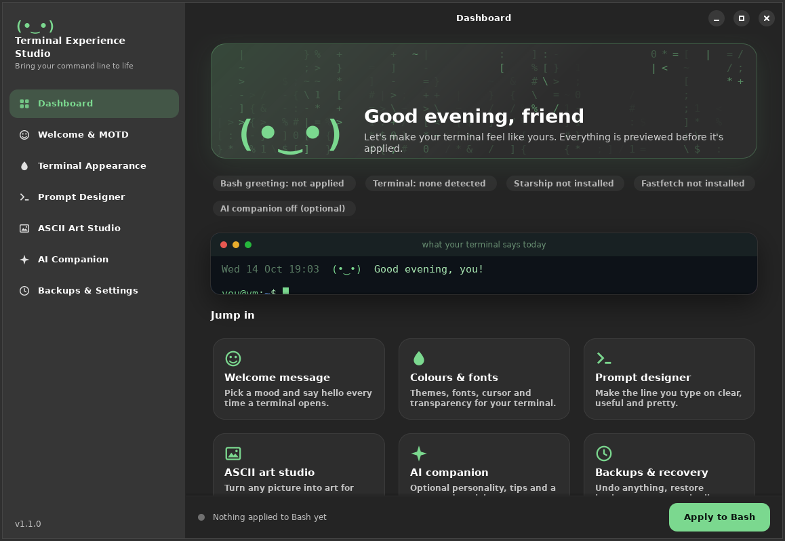
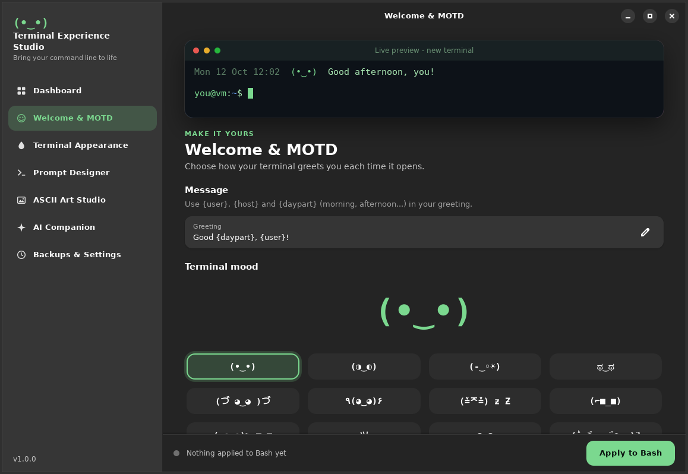
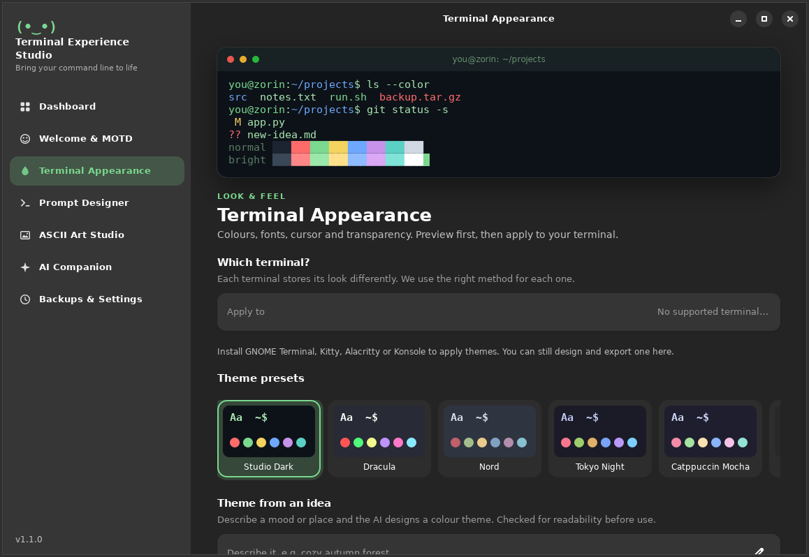
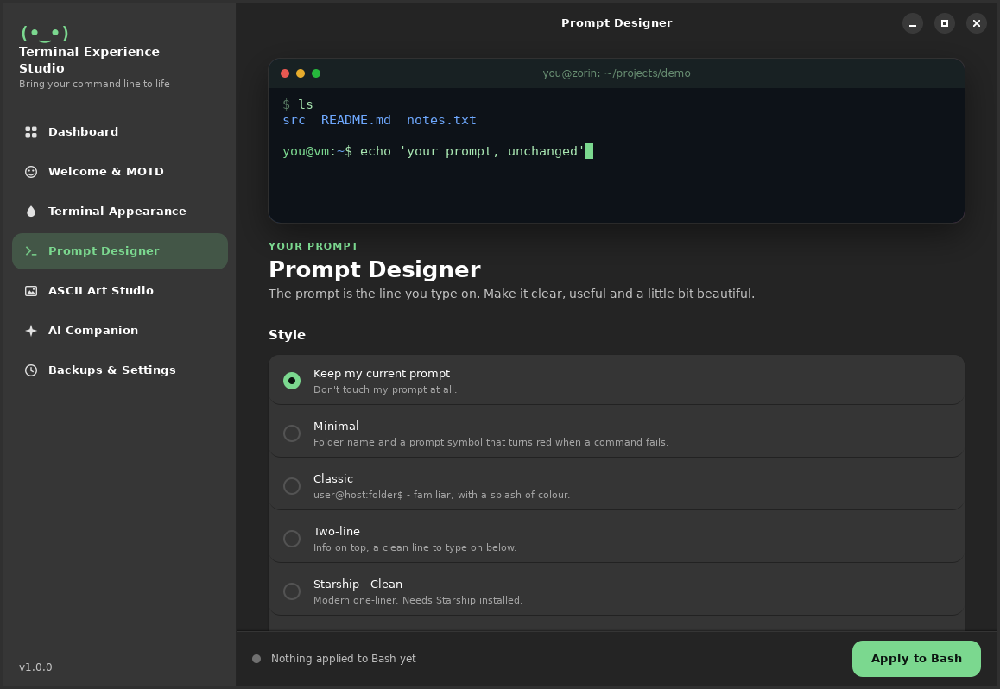
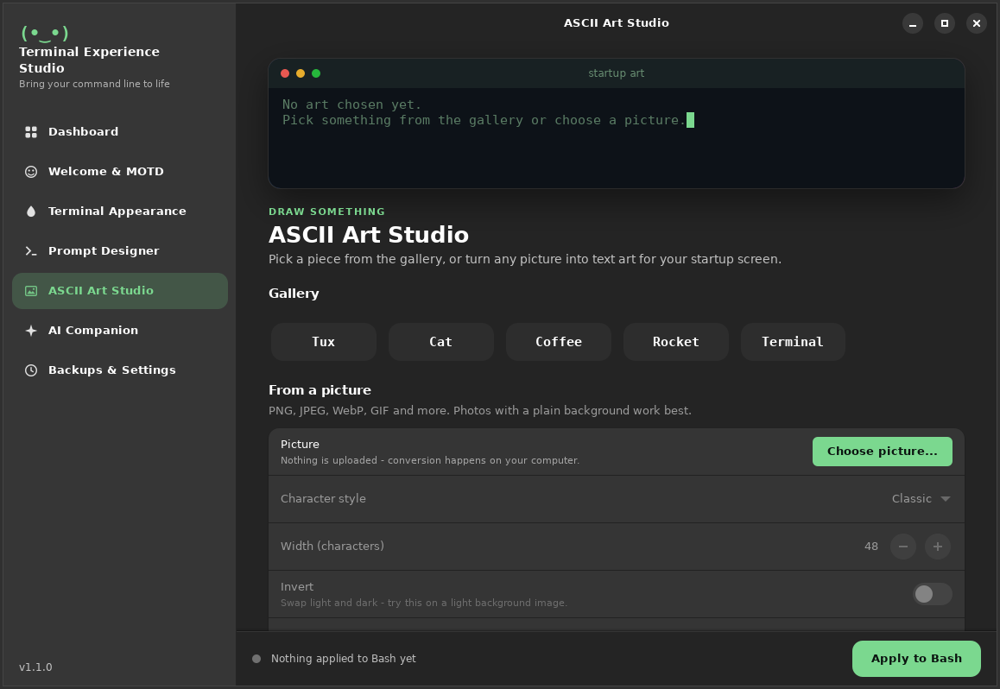
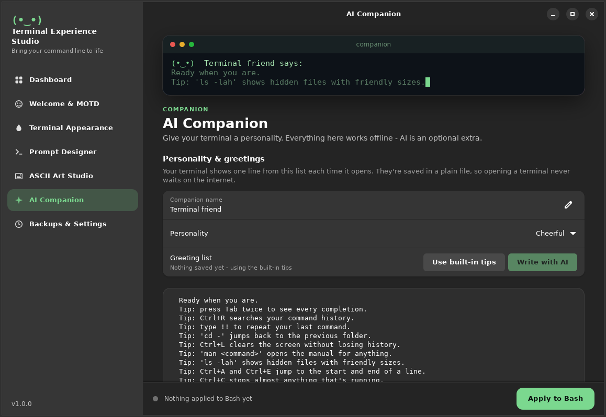
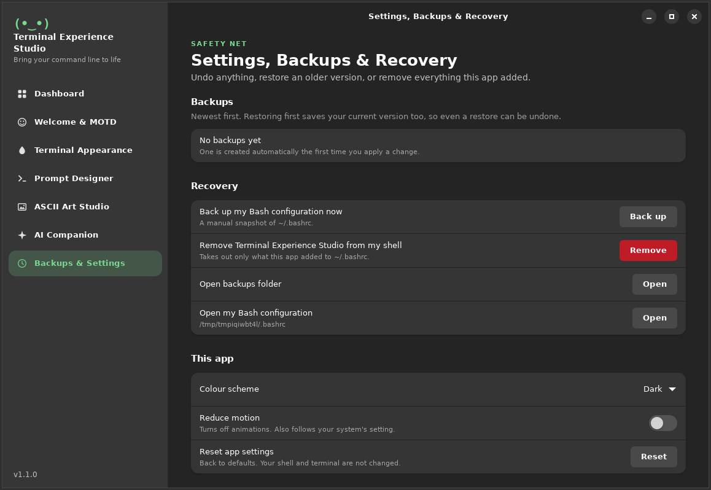

<div align="center">

# Terminal Experience Studio

**Bring your command line to life.**

A friendly Linux desktop app that customises your terminal without editing config files.
Live previews, one-click Apply, and Undo for everything.




</div>

---

## Why this exists

Making a terminal feel personal usually means hunting through hidden config files, copying snippets from
forums, and hoping you can undo it later. Terminal Experience Studio gives you switches, sliders and
presets instead. You see exactly what you'll get before anything touches your system, and every change
can be undone.

It's made for two kinds of people:

- **Beginners** who want a welcoming, good-looking terminal without learning configuration syntax.
- **Advanced users** who want control over prompts, themes, startup behaviour and AI features.

## Features

### Welcome & MOTD
Choose how your terminal greets you. Write a greeting using `{user}`, `{host}` and `{daypart}`
(morning, afternoon, evening), pick one of 24 moods, add rotating tips, an extra message and an optional
Fastfetch summary. The preview types itself out just like the real thing.



### Terminal Appearance
10 theme presets, colours, a 16-colour palette, font, size, cursor shape, opacity and background image.
Themes are applied the right way for each terminal, and the app tells you plainly when a terminal can't
do something (for example, GNOME Terminal has no background-image setting). Themes can be exported and
imported as small files.

| Terminal | Colours | Palette | Font | Cursor | Opacity | Background image |
|---|:-:|:-:|:-:|:-:|:-:|:-:|
| GNOME Terminal | yes | yes | yes | yes | yes | no |
| Kitty | yes | yes | yes | yes | yes | yes (PNG) |
| Alacritty | yes | yes | yes | yes | yes | no |
| Konsole | yes | yes | yes | yes | yes | no |



### Prompt Designer
Pick a prompt style with a live preview that shows both a normal command and a failed one. Minimal,
Classic and Two-line work in plain Bash with nothing to install. Two more styles use
[Starship](https://starship.rs) if you have it.



### ASCII Art Studio
Start from the built-in gallery, or turn any picture into text art with live controls for width,
contrast, brightness, invert and character style. Conversion happens on your computer, and the art can
appear above your greeting when a terminal opens.



### AI Companion
Everything here works offline: built-in tips and a command explainer that gives clear warnings for risky
commands such as `rm -rf /`. If you like, connect **Groq, OpenAI, OpenRouter** or a local **Ollama** to
write greetings in a personality you choose, or to explain commands in more detail. Greetings are saved
to a plain file, so opening a terminal never waits on the internet.



### Backups & Recovery
Restore any backup, remove everything the app added, switch between dark and light mode, or turn off
animations.



**Keyboard:** `Ctrl+1` to `Ctrl+7` jump between pages.

## Install

**Requirements:** a GNOME-based Linux desktop (built for Zorin OS 18 / Ubuntu 24.04), Python 3.10 or newer,
and Bash.

```bash
# 1. Dependencies (usually already installed on Zorin OS)
sudo apt install python3-gi gir1.2-gtk-4.0 gir1.2-adw-1 librsvg2-common

# 2. Get the app
git clone https://github.com/AbduLz0/fun-cli.git
cd fun-cli

# 3a. Try it straight from the folder...
./run.sh

# 3b. ...or install it for your user (menu entry + launcher, no sudo)
./install.sh
