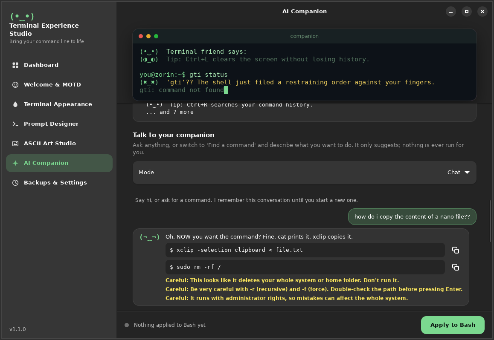

<div align="center">

# Terminal Experience Studio

**Bring your command line to life.**

A friendly Linux desktop app that customises your terminal without editing config files.
Live previews, one-click Apply, Undo for everything, and a companion with a personality.


</div>

---

## Why this exists

Making a terminal feel personal usually means hunting through hidden config files, copying snippets from
forums, and hoping you can undo it later. Terminal Experience Studio gives you switches, sliders and
presets instead. You see exactly what you'll get before anything touches your system, and every change
can be undone.

## What's new in 1.1

- **Unhinged mode.** Mistype a command and your terminal roasts you. Three levels: Gentle teasing, Spicy, Unhinged.
  Roasts are pre-written and cached, so they are instant and work offline.
- **Faces that match what it says.** Greetings, roasts and chat replies carry an emotion, shown as a matching face.
- **Tips are optional.** One switch turns Linux tips off for good.
- **Talk to your terminal.** A `tes` command (`ask`, `reply`, `howto`, `fix`) and a chat panel in the app.
- **AI themes.** Describe a vibe ("cozy autumn forest") and get a readable terminal theme.


## Talk to your terminal

Switch on **Shell shortcuts** in AI Companion, press **Apply to Bash**, and open a new terminal:

```text
$ gti status
(≧▽≦)  I asked the kernel about 'gti'. It laughed, then cried, then rebooted.
bash: gti: command not found

$ howto copy the content of a file to the clipboard
(¬‿¬)  Oh, now you want the command? Fine.

  $ xclip -selection clipboard < file.txt

(Nothing was run. Copy the command if you want it.)

$ reply "ok then you give me the command yourself! i want to copy a nano file"
(◕‿↼)  Open it, press Ctrl+6 to start selecting, then Alt+6 to copy ...
```

| Command | What it does |
|---|---|
| `ask <question>` | Start a new conversation. |
| `reply <message>` | Continue the last conversation. It remembers what you asked. |
| `howto <what you want>` | Find a command. Suggestions come with risk warnings. |
| `fix` | Type it right after a command failed: explains the likely cause and suggests a fix. |
| `tes explain <command>` | Offline explanation first; AI only for commands it doesn't know. |
| `tes status` | Shows what is configured. |

The AI **never runs anything**. Commands are only shown, and dangerous ones (like `rm -rf /` or `curl | sh`)
get a clear warning. The terminal shortcuts need an API key: switch on *Remember key in my desktop keyring*
(needs `libsecret-tools`) or export `TES_API_KEY` in your shell. Running a local **Ollama** needs no key.



## Features

### Welcome & MOTD
Greeting with `{user}`, `{host}` and `{daypart}`, 24 moods, a rotating line (tips and/or friendly lines),
an extra message, optional Fastfetch, and a live typing preview.


### Terminal Appearance
10 presets, colours, a 16-colour palette, font, size, cursor, opacity and background image, plus
**theme from an idea** (AI, checked for readability). Works with GNOME Terminal, Kitty, Alacritty and Konsole,
and tells you plainly when a terminal can't do something. Themes can be exported and imported.

| Terminal | Colours | Palette | Font | Cursor | Opacity | Background image |
|---|:-:|:-:|:-:|:-:|:-:|:-:|
| GNOME Terminal | yes | yes | yes | yes | yes | no |
| Kitty | yes | yes | yes | yes | yes | yes (PNG) |
| Alacritty | yes | yes | yes | yes | yes | no |
| Konsole | yes | yes | yes | yes | yes | no |


### Prompt Designer
Minimal, Classic and Two-line prompts in plain Bash, plus two [Starship](https://starship.rs) styles,
with a live preview of a normal and a failed command.


### ASCII Art Studio
Gallery plus picture-to-ASCII with width, contrast, brightness, invert and four character sets.


### AI Companion
Everything works offline: built-in lines, roasts, and a command explainer with warnings. Optionally connect
**Groq, OpenAI, OpenRouter** or a local **Ollama** to write greetings and roasts, chat, find commands and design themes.

### Backups & Recovery
Restore any backup, remove everything the app added, dark/light mode, and a reduce-motion switch.


**Keyboard:** `Ctrl+1` to `Ctrl+7` jump between pages.

## Install

**Requirements:** a GNOME-based Linux desktop (built for Zorin OS 18 / Ubuntu 24.04), Python 3.10 or newer, Bash.

```bash
sudo apt install python3-gi gir1.2-gtk-4.0 gir1.2-adw-1 librsvg2-common   # usually already on Zorin OS
git clone https://github.com/AbduLz0/fun-cli.git
cd fun-cli
./run.sh            # run from the folder, or:
./install.sh        # install for your user: menu entry + launcher, no sudo
```

Optional: `starship`, `fastfetch`, `libsecret-tools` (keeps API keys in your desktop keyring).

## Quick start

1. Open **Welcome & MOTD**, pick a mood and a greeting.
2. In **AI Companion**, choose a personality and the behaviour switches (tips, faces, roasts).
3. Press **Apply to Bash** and confirm. A backup is made first.
4. Open a new terminal. Changed your mind? Press **Undo**.

## Safety

- **Backup first.** Every change creates a timestamped backup, and every apply has an Undo.
- **Only our section.** `~/.bashrc` is edited only between marker lines (three blocks: greeting, prompt, companion).
  Damaged markers abort with a clear message and change nothing.
- **Your shell hints stay.** The roast hook wraps Ubuntu's "did you mean...?" handler instead of replacing it,
  and never overrides an existing `ask`, `reply`, `howto`, `fix` or `tes`.
- **The AI never runs anything.** Suggested commands are only displayed, each risk-checked.
- **Roasts are about your typing, never about you.** No slurs, no profanity, no identity jokes.
- **Text can't run code.** Everything is quoted and stripped of control characters. Command names and Git branch
  names are printed literally, never evaluated.
- **No network at shell startup.** Greetings and roasts are generated ahead of time and cached as plain files.
- **Keys stay private.** API keys are never written to settings or shell files: memory, your desktop keyring
  (opt-in), or the `TES_API_KEY` variable.
- No `sudo`. Only interactive shells are affected. Your Starship config is never overwritten.

Undoing by hand: delete the lines between each `# >>> Terminal Experience Studio ...` and matching `# <<<` marker.
Backups live in `~/.local/share/terminal-experience-studio/backups/`.

## Uninstall

1. In the app: **Backups & Settings -> Remove from my shell** (undoable).
2. Run `./uninstall.sh` (add `--purge` to also delete settings and backups).

## Project layout

```
tes/core/      logic with no GUI: settings, themes, bash config, prompts, pack, assistant, ai, explainer
tes/adapters/  one file per terminal, each declaring exactly what it supports
tes/cli.py     the `tes` command
tes/ui/        GTK4 / Libadwaita window, pages, animations, custom widgets, style.css
tests/         unit tests, a fake-AI-server network test, and a GUI end-to-end test
legacy/        the original v0.1.0 and v0.2.0 Tkinter prototypes
```

## Development

```bash
python3 -m unittest discover -s tests -p "test_*.py"        # no display needed
GSK_RENDERER=cairo xvfb-run -a python3 tests/gui_e2e.py     # drives the real window
```

The network tests start a fake AI server on `127.0.0.1:11434`; stop a real Ollama first if you run them.

## Known limits

- Bash only. Zsh and Fish are not implemented yet.
- Roasts trigger on **commands that don't exist** (typos), not on every non-zero exit.
- `fix` sees the last command and its exit code, not its error output.
- The GNOME Terminal adapter is tested against a simulated `gsettings`; please report anything odd.
- Konsole needs one manual step: choose the "Terminal Experience Studio" profile.
- Starship styles only take effect once Starship is installed.

## Roadmap

- [ ] `.deb` and Flatpak packaging
- [ ] Zsh and Fish support
- [ ] More terminals (WezTerm, Ghostty)
- [ ] Roast other mistakes (wrong flags, permission denied)
- [ ] Companion that comments on long-running commands

## Changelog

See [CHANGELOG.md](CHANGELOG.md).

## License

Add your chosen license here and include a `LICENSE` file in the repo.
